# Astro: B2C astrology consultation app

A Flutter app where **users** find astrologers and consult them over **chat, voice and video**, and **astrologers**
log in separately to accept or decline those requests.

Flutter · Bloc · Firebase (Auth, Firestore, Cloud Functions, Cloud Scheduler) · VideoSDK (voice and video)

> Android and iOS only. The VideoSDK Flutter plugin (5.x) does not support web.

## Screenshots

Every page, rendered with realistic data (regenerate with `scripts/capture_screens.sh`):

| Login, signup, profile forms | Astrologer list, detail, states |
|---|---|
| 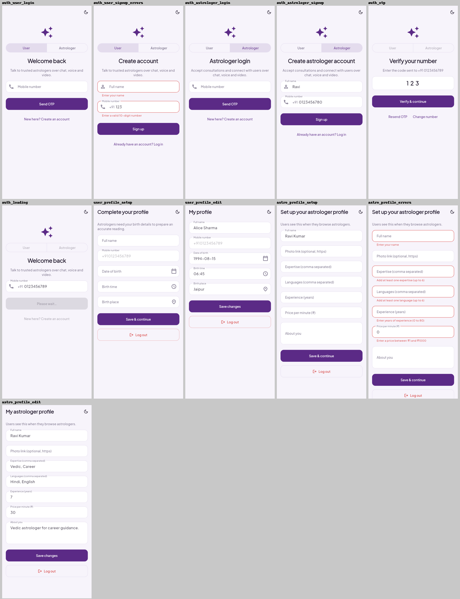 | 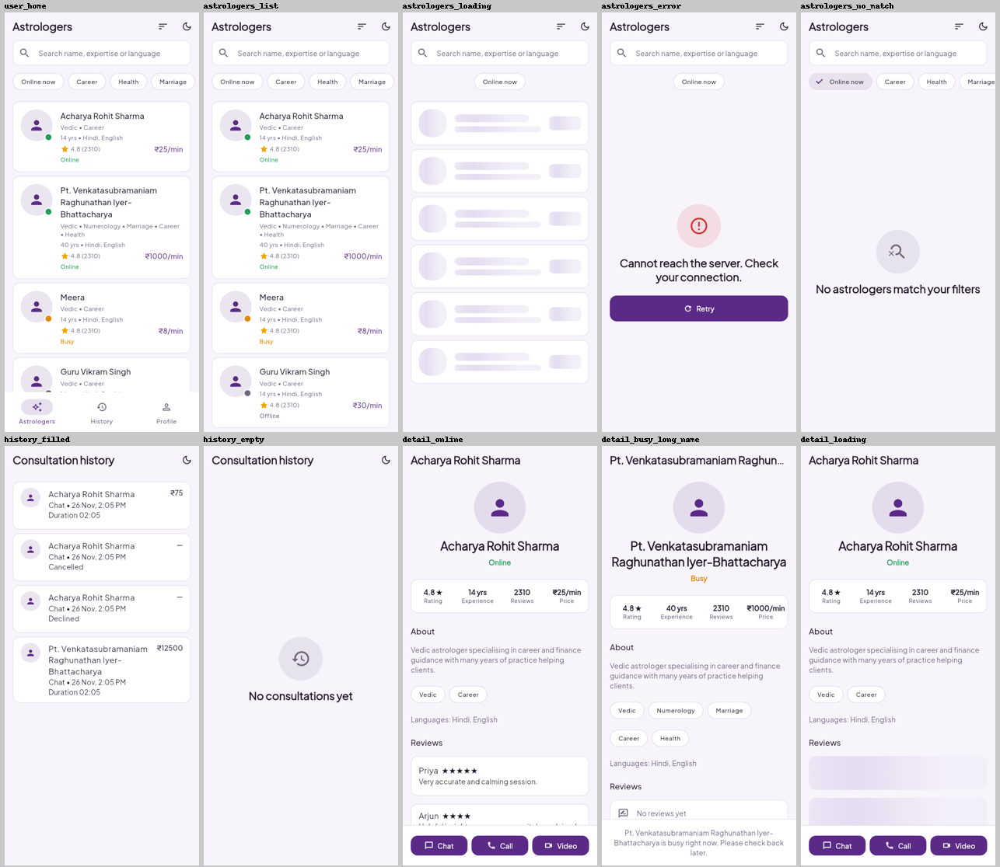 |
| **Session and chat** | **Astrologer dashboard and calls** |
| 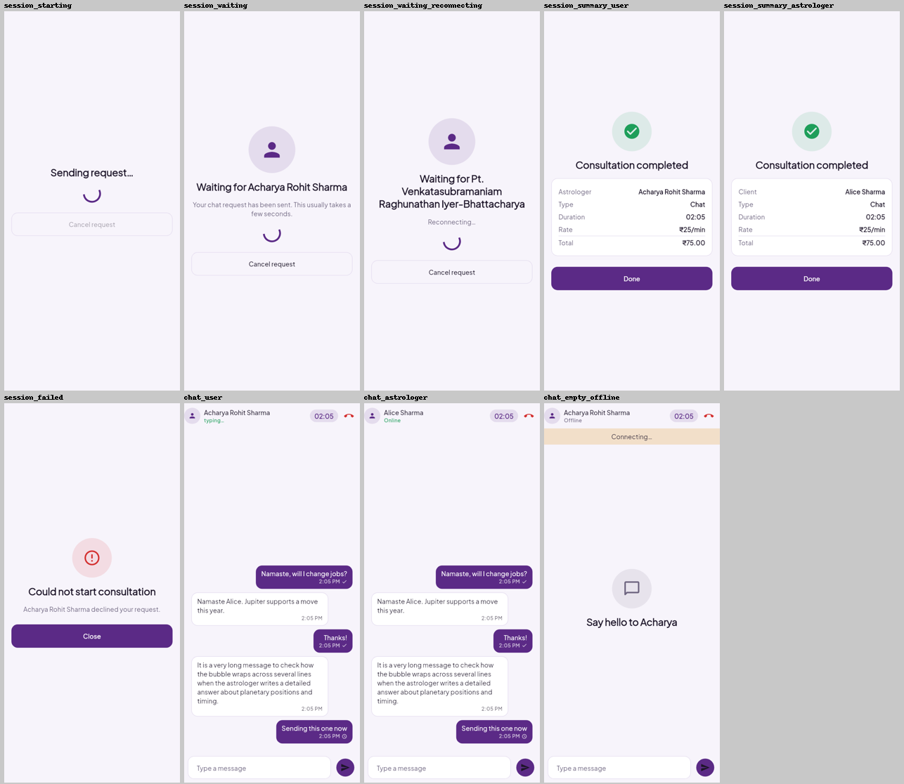 | 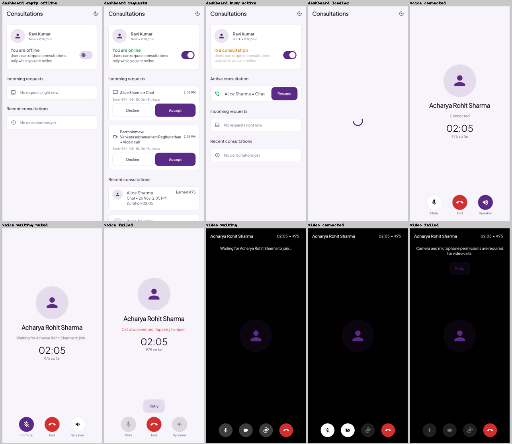 |

<p>
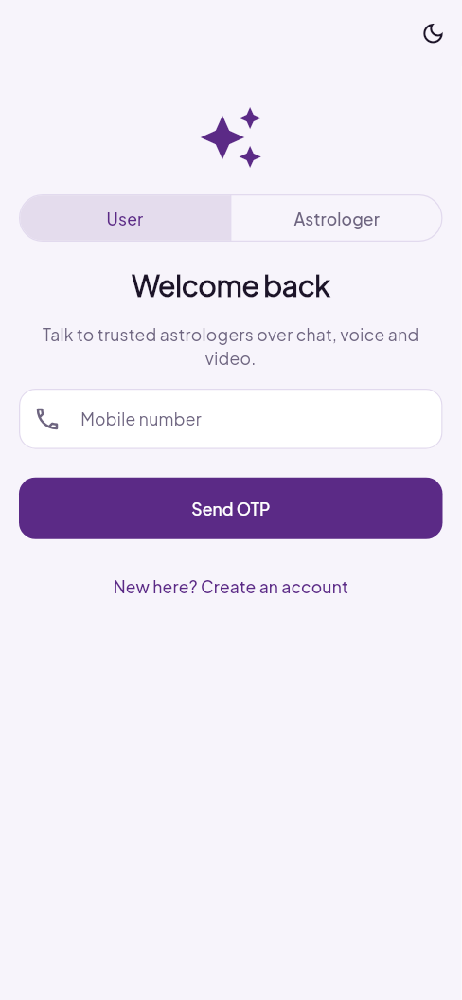
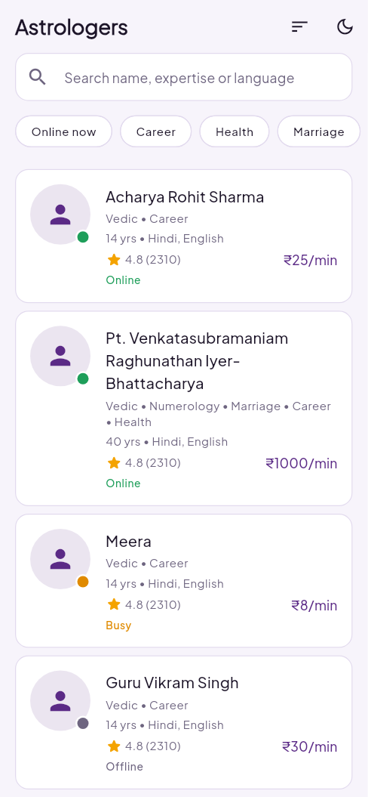
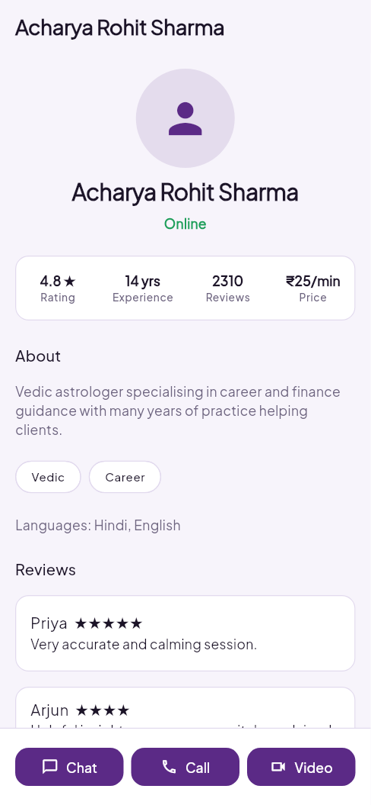
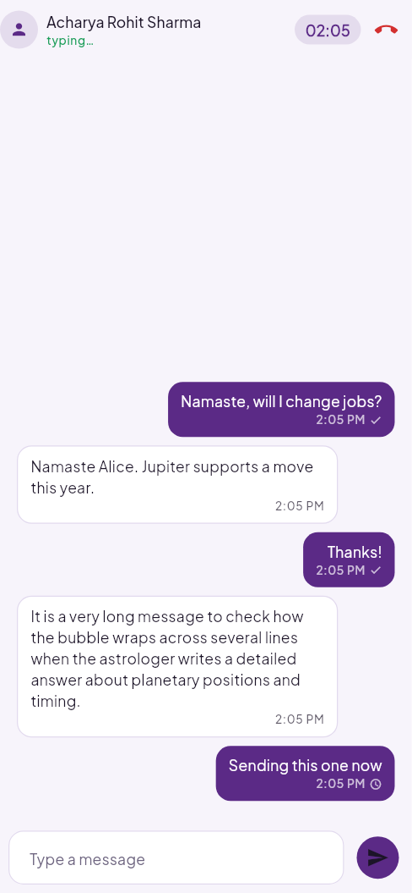
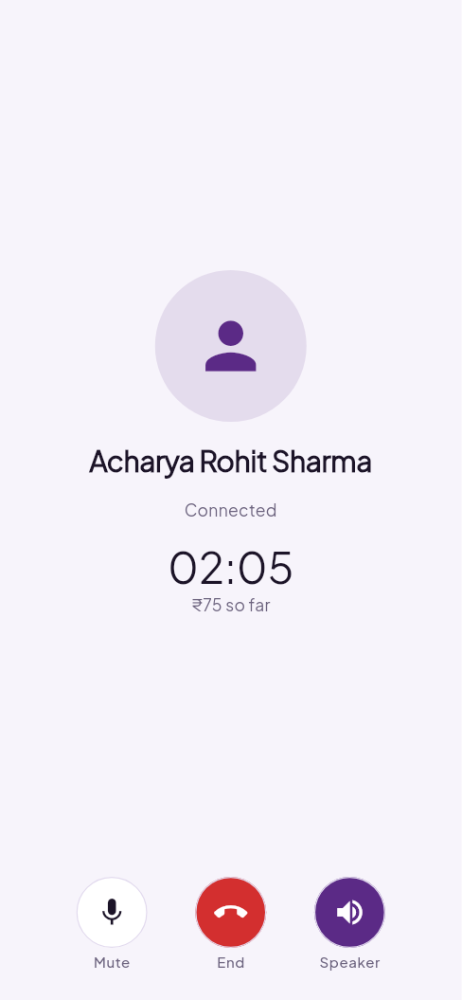
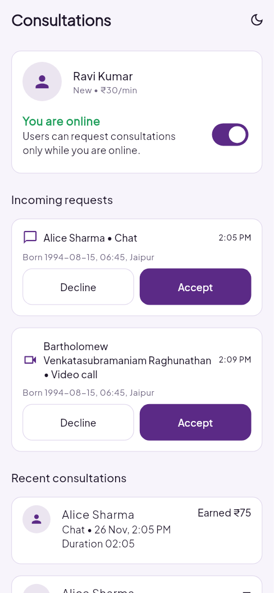
</p>

## End-to-end flow

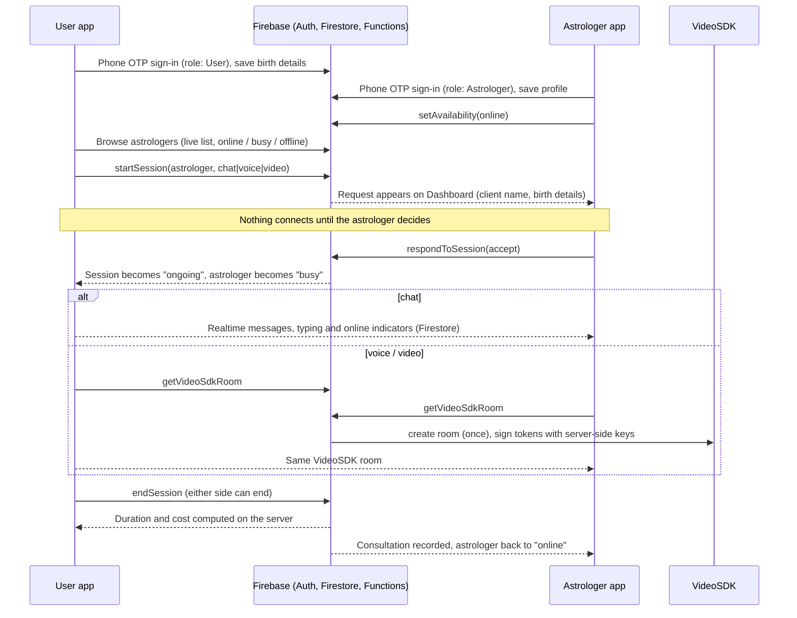

1. **Sign in.** The login screen has a **User / Astrologer** switch. A phone number belongs to one role for good, and
   the other portal refuses it. Verification is phone OTP through Firebase Auth.
2. **Astrologer onboarding.** An astrologer saves a profile (name, expertise, languages, experience, price per
   minute, about) and turns **online** on the Dashboard. Only then can users book them.
3. **User onboarding.** A user saves name, date, time and place of birth. Astrologers see these on each request.
4. **Request.** The user opens an astrologer and taps Chat, Call or Video. The request waits (up to 60 s) and can be
   cancelled.
5. **Accept or decline.** The astrologer sees it live on the Dashboard and taps Accept or Decline. A declined request
   is free and the user is told. Nobody is connected automatically.
6. **Consultation.** Chat uses Firestore realtime listeners. Voice and video join one shared VideoSDK room. Both
   sides see a running timer and cost.
7. **End.** Either side ends it. Duration and cost are computed on the server, and the consultation appears in both
   histories.

## Project structure

```
lib/main.dart
lib/app_constants.dart                  every string, endpoint, collection / field / function name and config value
lib/features/<feature>/<feature>_{model,state,controller,view}.dart
  theme · auth · profile · home · astrologers · astrologer_detail · session · chat · voice_call · video_call
  astrologer_profile · astrologer_dashboard
functions/                              Cloud Functions (Node 22); constants.js holds every identifier and message
firestore.rules  firestore.indexes.json  firebase.json
test/                                   unit tests, layout renders, production end-to-end tests
scripts/capture_screens.sh              re-takes every screenshot
docs/layout_review/                     screenshots
```

House rules, all enforced in code review and by the layout tests:

- exactly four files per feature (model, state, controller, view); state management is Bloc;
- every widget is stateless, and state lives in the cubits;
- no fixed heights, only padding, margin and spacing;
- no hardcoded strings outside `app_constants.dart` (and `functions/constants.js`);
- one shared theme (`theme` feature) with one page gutter and one icon-colour scheme.

## Backend

| Piece | Implementation |
|---|---|
| Auth | Firebase phone OTP. Profile in `users/{uid}` (role is fixed at sign-up). |
| Catalogue | `astrologers/{uid}`, streamed live. Written only by the `saveAstrologerProfile` and `setAvailability` functions. |
| Sessions | `startSession`, `respondToSession`, `endSession` callables. Clients cannot write sessions directly. Start is atomic, so a double tap makes one session. |
| Chat | Firestore realtime listeners on `sessions/{id}/messages`, plus `presence` documents for typing and online state. |
| Calls | `getVideoSdkRoom` returns a token and one shared room per session. The VideoSDK API key and secret live in Secret Manager and never reach the client. |
| Housekeeping | `expireStaleSessions` (Cloud Scheduler, every 30 min) closes abandoned requests and calls and frees the astrologer. |
| Security | `firestore.rules`: participants-only reads, role-checked message writes, no client writes to billing or status. |

## Setup

Requirements: Flutter (stable), Node 22, Firebase CLI, a Firebase project on the **Blaze** plan (needed for Cloud
Functions and phone auth), a [VideoSDK](https://app.videosdk.live) account.

```bash
# 1. Firebase project: create it, enable Phone sign-in and Firestore, register the Android and iOS apps
firebase login
#    Auth: allow SMS for your country (Authentication → Settings → SMS region policy)

# 2. Client config. These files are deliberately NOT in git:
firebase apps:sdkconfig ANDROID <android-app-id> --out android/app/google-services.json
firebase apps:sdkconfig IOS     <ios-app-id>     --out ios/Runner/GoogleService-Info.plist
#    Android phone auth also needs your signing key's SHA-1 and SHA-256 added to the Firebase Android app.

# 3. VideoSDK credentials go to Secret Manager (never into the repo or the app)
printf '<api key>' | firebase functions:secrets:set VIDEOSDK_API_KEY --data-file -
printf '<secret>'  | firebase functions:secrets:set VIDEOSDK_SECRET  --data-file -

# 4. Deploy rules, indexes and functions
(cd functions && npm install)
firebase deploy --only firestore,functions

# 5. Run
flutter pub get
flutter run
```

Set your project id in `.firebaserc`, and your region in `AppConfig.functionsRegion` and `functions/constants.js`.

## Build

```bash
flutter build apk --release        # needs the Android SDK
flutter build ios                  # needs macOS and Xcode
```

The release build above is signed with the debug key for testing. Use your own upload key for the Play Store.

## Tests

| Suite | Command | What it covers |
|---|---|---|
| Unit | `flutter test test/logic_test.dart` | State, validation and model logic |
| Layout | `flutter test test/layout/layout_test.dart` | Renders every page at 6 sizes, themes and text scales, and fails on any overflow |
| Production end-to-end | `TEST_PHONES="+91…,+91…,+91…,+91…" TEST_OTP=<code> ADMIN_TOKEN=$(gcloud auth print-access-token) node test/prod/prod_e2e.mjs` | Real phone sign-in, real Firestore rules, real Cloud Functions and Scheduler, real VideoSDK rooms. No mocks. |

The production suite signs in as two users and two astrologers (Firebase test phone numbers that are set aside for the tests
and deleted afterwards). It checks that nothing connects without the astrologer's Accept, that roles cannot
impersonate each other, that billing is server-side, that a double tap makes one session, and that both parties get
the same valid VideoSDK room. Use dedicated test numbers, never real ones. The admin token is used only to plant
stale sessions and to clean up.

## Security notes

- **Not in this repo:** the VideoSDK key and secret (Secret Manager), the Firebase client config files, signing keys,
  and any tokens.
- The server never trusts the client for status, billing, or who is the astrologer.
- If you ever paste a token or key into a chat or a terminal log, rotate it.
